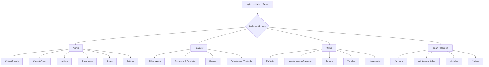

# 2. Roles, Permission Matrix, Journeys

## 2.1 Role model

One login for everyone. After authentication, the user's **role assignments** and **unit relationships** determine dashboards and permissions.

| Concept | Meaning | Stored in |
|---|---|---|
| **Role** (authority) | ADMIN (committee), TREASURER | `user_role_assignments` (society-scoped, with start/end dates) |
| **Relationship** (to a unit) | OWNER, CO_OWNER, TENANT, RESIDENT_MEMBER | `unit_ownerships`, `occupancies` |
| **Person** | Real-world individual; may not have a login | `persons` |
| **User account** | Login credentials linked to one person | `users` |

**Platform operator (outside the society role model):**  
A PLATFORM_ADMIN exists only in the control plane ([doc 10](10-multi-tenancy.md)), signs in at a separate hostname with mandatory MFA, and has **no access to any society's resident data** through the application. Operator actions (provision, migrate, suspend, rotate secrets, backups) are audited in the platform audit log. Break-glass access to a society's database is an out-of-band, logged, time-boxed procedure approved by that society's admin. Each society's roles, users and permissions below are scoped to that society's own database.

### Key rules:
1. **Ownership never implies administrative authority.** OWNER is derived from `unit_ownerships`; ADMIN/TREASURER come only from explicit assignments made by an admin.
2. A user may hold several roles (e.g., Owner of A-101 and B-204, Tenant elsewhere, and Treasurer). Effective permissions are the **union**, each evaluated against its own scope (unit-scoped vs society-scoped).
3. Role-assignment changes require MFA re-verification, are audited, and the last active admin cannot be removed.
4. Treasurer is not a superset of Admin; Admin cannot silently alter financial records (see matrix: corrections go through audited adjustments).

---

## 2.2 Permission matrix

**Legend:**  
* **S** = society-wide  
* **U** = own units only (record-level check; "own units" for an owner = units with an active ownership; for a tenant = unit of active occupancy)  
* **O** = own record only  
* **-** = none  
* **R** = read  
* **W** = write  
* **A** = approve  

| Capability | Admin | Treasurer | Owner | Tenant / Resident |
|---|---|---|---|---|
| Society settings, buildings, units | S RW | S R | U R | U R (basic) |
| Invite/deactivate users | S RW | - | - | - |
| Assign Admin/Treasurer roles | S RW (MFA, dual-confirm optional) | - | - | - |
| Owner records / ownership history | S RW | S R (billing contact) | U R (own) | - |
| Joint-owner contact details | S R | - | U R (co-owners of same unit) | - |
| Tenant & occupancy records | S RW | S R | U RW (own units' tenants) | U R (own) |
| Vehicles | S RW | - | U RW | U RW (own unit, if owner enables) |
| Parking allocation | S RW | - | U R | U R |
| Notification preferences | O | O | O | O |
| Society-wide documents | S RW | S R, upload financial | R | R |
| Private documents (unit) | S R only if shared/for legal reason (audited) | - | U RW | U R/W where shared by owner |
| Notices | S RW | W (payment reminders) | R | R |
| Maintenance configuration (components, late fee) | S R, propose | S RW | - | - |
| Generate bills | - | S W | - | - |
| View bills / balance | S R | S R | U R | U R (if enabled, Q7) |
| Record offline payment | - | S W (audited) | - | - |
| Pay online | - | - | U W | U W (if enabled) |
| Waive/adjust bill | - | Request | - | - |
| Approve adjustment/waiver > threshold | S A | Request (maker-checker) | - | - |
| Refund | - | Initiate | - | - |
| Refund approval | S A | - | - | - |
| Receipts | S R | S RW (regenerate/void with audit) | U R | U R |
| Financial reports | S R (summary) | S R full + export | U R (own ledger) | - |
| Membership cards | S RW (issue/revoke) | R | U R (own) | O R (own) |
| Verify card (QR) | Public minimal result (valid/invalid + masked name) | same | same | same |
| Building map | S RW | R | R | R (restricted layers hidden) |
| Audit log | S R | S R (financial events) | - | - |
| Data export / erasure requests | S process | - | O request | O request |

**Maker-checker:** adjustments, waivers, refunds, and role changes are created by one actor and approved by a different actor (configurable; with a very small committee, minimum is a different person than the creator).

**Enforcement:** server-side only. UI hiding is cosmetic. See [security](05-security-privacy.md) section 5.3.

---

## 2.3 User journeys

| Journey | Steps (targets number of clicks) |
|---|---|
| **Onboard resident / owner** | Admin invites via email → recipient receives tokenized link → accepts invite & sets password/MFA → profile linked to person/unit record. |
| **Pay maintenance bill** | Resident navigates to Dashboard → views outstanding bill → clicks "Pay Online" → redirected to hosted gateway → returns with payment receipt. |
| **Record offline payment** | Treasurer navigates to Unit Ledger → records offline cheque/NEFT reference and amount → system issues receipt and writes audit log. |
| **Publish notice** | Admin creates notice → attaches target audience (all / building-specific) → publishes → triggers notification engine. |

---

## 2.4 Navigation structure

The screenshot shows a role-based navigation model driven by the user’s current role, not a static menu. The design is best represented as one dashboard shell that switches submenus depending on whether the user is Admin, Treasurer, Owner, or Resident.

### Interpretation from the screenshot

- The root is a shared dashboard, not a role-switching screen.
- Each role sees different widgets and different submenu items.
- The same user may hold multiple roles, but the dashboard should present the role-specific context for the current action.
- The top-level navigation is intentionally small: around 5-6 modules maximum, with a More option for mobile.
- A dedicated role switcher is unnecessary; the dashboard should adapt by role and by unit context automatically.

### Example of role-specific behavior

- Admin: units, people, users, notices, documents, cards, settings
- Treasurer: billing cycles, payments, receipts, reports, adjustments
- Owner: my units, maintenance, tenants, vehicles, documents
- Resident: home, maintenance and payment, vehicles, notices

This matches the structure in the screenshot more closely than a static menu list and is the clearest way to express the navigation model in the document.
