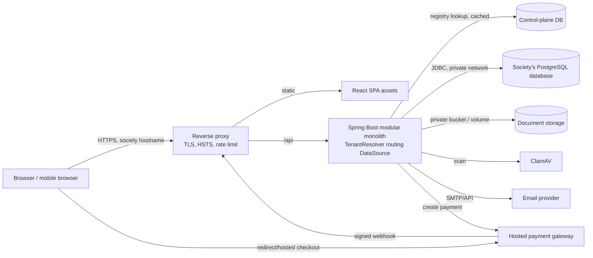
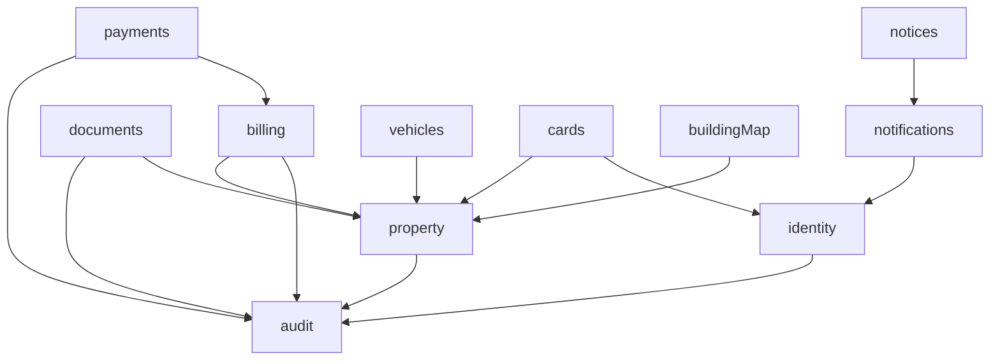

# 3. Architecture, Modules, REST API

## 3.1 System architecture

> Multi-society: the diagram below shows one society's request path. In the platform, the proxy maps the hostname to a runtime group, a TenantResolver selects the society, and a routing DataSource connects to **that society's own database**. See the fleet topology in [doc 10, section 10.2](10-multi-tenancy.md).



**Principles:** one deployable backend; DB and storage not internet-reachable; background jobs run inside the same app (Spring scheduling + DB-backed job table with `SELECT ... FOR UPDATE SKIP LOCKED`); no message broker; no Redis in MVP (sessions in PostgreSQL; add cache only if measured need).

---

## 3.2 Recommended versions (verify at project start)

| Component | Recommendation | Note |
|---|---|---|
| Java | Current LTS | Check support timeline |
| Spring Boot | Latest GA of a supported line | Check spring.io support calendar |
| PostgreSQL | Current major supported (17 or 18) | Community support is 5 years per major |
| Node | Current LTS | Not a runtime for the backend |
| React | Current stable | Use TypeScript |
| Nginx / Traefik / CDN | Reverse proxy in front | TLS, rate limiting, static hosting |

---

## 3.3 Backend modules (package-by-feature)



| Module | Responsibility | Exposes (internal API) |
|---|---|---|
| `identity` | Users, invitations, login, MFA, sessions, role assignments | `CurrentUser`, `AccessPolicy` |
| `property` | Society, buildings, floors, units, owners, tenants, occupancy | `UnitAccessQuery` (who relates to which unit) |
| `vehicles` | Vehicles, parking slots/allocations | `VehicleService` |
| `documents` | Metadata, storage port, scan pipeline, secure download | `DocumentService` |
| `notices` | Notifications, in-app notifications, email outbox, preferences | `NotificationPublisher` |
| `billing` | Charge components, cycles, bills, adjustments, ledger | `BillingService` |
| `payments` | Gateway port/adapter, payment attempts, webhook inbox, allocation, refunds, receipts | `PaymentGateway` |
| `cards` | Membership cards, QR token verification | `CardVerificationService` |
| `buildingMap` | Map assets and unit hotspots | `MapService` |
| `audit` | Append-only audit events | `AuditRecorder` |
| `tenancy` | Host tenant resolution, `TenantContext`, routing DataSource and per-tenant pools, fleet-aware flyway, tenant-scoped cache | `TenantContext` |
| `tenant-config` | Validated per-society config (theme, features, extensions, limits); public subset for the SPA | `TenantConfig` |
| `platform` | Config, error handling, rate limiting, tenant-aware job runner, logging | `PlatformConfig` |

The control plane (`platform-app`, provisioning library, `societyctl`) is a separate application sharing libraries only; see [doc 10](10-multi-tenancy.md).

Rules enforced with ArchUnit (or Spring Modulith): modules interact via public service interfaces; no cross-module repository access; billing is the only writer to bills/ledger; payments is the only writer to payments.

Internal layering per module: `web` (controllers, DTOs) -> `application` (use cases, transactions, authorization checks) -> `domain` (entities, policies) -> `infra` (JPA/JDBC, adapters). Use DTOs at the boundary; never expose entities.

---

## 3.4 Frontend organisation

src/
  app/
  api/
  auth/
  features/
    dashboard/
    units/
    people/
    vehicles/
    documents/
    notices/
    billing/
    payments/
    cards/
    admin/
  components/
  styles/
  hooks/

**Per-society variation:** one build; at startup the SPA fetches `GET /api/v1/public/tenant-config`, applies the theme tokens as CSS variables, builds route menus from feature flags, and lazy-loads optional per-society extension chunks that fill typed slots (`extensions/<tenant>`). Layout is `core/`, `features/`, `design-system/`, `extensions/`; rules and contracts in [doc 10, section 10.6](10-multi-tenancy.md).

State: TanStack Query for server state; local state otherwise (no Redux).

Routing: React Router with route-level code splitting (`lazy`).

UI: plain CSS modules or a utility CSS approach; accessible primitives written in-house or a small headless library. No heavy component suites.

Types generated from the backend OpenAPI document to prevent drift.

Client-side permission checks only hide UI; every API call is re-authorized server-side.

---

## 3.5 REST conventions

- Base path `/api/v1`; JSON; ISO-8601 UTC timestamps; money as `{"amount":"1250.00","currency":"INR"}` string decimals.
- IDs: UUID (v7 preferred) to avoid enumeration; authorization still enforced.
- Pagination: `?page=0&size=20` (max 100) with `X-Total-Count`, or cursor for large lists. Sort whitelist.
- Idempotency: `Idempotency-Key` header required on payment-initiation, bill generation, refund POSTs.
- Concurrency: `ETag` / `If-Match` (row version) on updates + `412` on conflict.
- CSRF: header `X-XSRF-TOKEN` on state-changing requests.
- Errors: RFC 9457 `application/problem+json`.

```json
{
  "type": "https://society.example/problems/validation-error",
  "title": "Validation failed",
  "status": 422,
  "detail": "One or more fields are invalid.",
  "instance": "/api/v1/vehicles",
  "traceId": "9f1c...",
  "errors": [{ "field": "registrationNumber", "code": "DUPLICATE", "message": "Already registered." }]
}
```

| Status | Use |
|---|---|
| 400 | Malformed request |
| 401 | Not authenticated / session expired |
| 403 | Authenticated but not permitted (also MFA step-up required; `code=MFA_REQUIRED`) |
| 404 | Not found |
| 409 | State conflict (duplicate, bill already paid) |
| 412 | Stale `If-Match` |
| 422 | Validation failed |
| 429 | Rate limited (`Retry-After`) |

---

## 3.6 Representative endpoints

| Area | Method + path | Roles / check |
|---|---|---|
| Tenant | `GET /public/tenant-config` (public subset: branding, locale, features, navigation, extension keys; no secrets) | Public, cached |
| Me | `GET /me`, `GET /me/units`, `PUT /me/notification-preferences`, `GET /me/sessions`, `DELETE /me/sessions/{id}` | Authenticated |
| Users | `POST /users/invitations`, `POST /users/{id}/deactivate`, `PUT /users/{id}/roles` | Admin |
| Units | `GET /units?building=&q=`, `GET /units/{id}`, `POST /units`, `PUT /units/{id}` | Admin (write); scoped read |
| Ownership | `GET /units/{id}/owners`, `POST /units/{id}/owners`, `POST /units/{id}/owners/{oid}/end` | Admin |
| Tenancy | `GET /units/{id}/occupancies`, `POST /units/{id}/occupancies`, `POST /occupancies/{id}/end` | Admin, unit owner |
| Vehicles | `GET /units/{id}/vehicles`, `POST /units/{id}/vehicles`, `DELETE /vehicles/{id}`, `GET /vehicles?reg=` (admin lookup) | Unit scope / Admin |
| Documents | `POST /documents` (multipart, metadata), `GET /documents?category=`, `GET /documents/{id}`, `POST /documents/{id}/download-link`, `POST /documents/{id}/archive` | Per visibility |
| Notices | `GET /notices`, `POST /notices`, `POST /notices/{id}/publish`, `POST /notices/{id}/archive` | Admin write |
| Notifications | `GET /notifications?unread=true`, `POST /notifications/{id}/read`, `POST /notifications/read-all` | Own |
| Billing config | `GET/PUT /billing/components`, `GET/PUT /billing/policy` | Treasurer |
| Cycles | `POST /billing/cycles` (preview), `POST /billing/cycles/{id}/issue` | Treasurer |
| Bills | `GET /bills?unit=&status=`, `GET /bills/{id}`, `GET /units/{id}/ledger` | Scoped |
| Payments | `POST /bills/{id}/payment-intents` (initiates), `GET /payment-intents/{id}` (status), `POST /payments/offline` | Owner / Treasurer |
| Webhook | `POST /webhooks/payments/{provider}` | Signature-verified, no session, CSRF-exempt |
| Adjustments | `POST /bills/{id}/adjustments`, `POST /adjustments/{id}/approve` | Treasurer / Admin |
| Refunds | `POST /payments/{id}/refunds`, `POST /refunds/{id}/approve` | Treasurer / Admin |
| Receipts | `GET /receipts/{id}/pdf` | Scoped |
| Reports | `GET /reports/collections?from=&to=`, `GET /reports/outstanding` (+ `.csv`) | Treasurer, Admin |
| Cards | `GET /me/card`, `POST /cards`, `POST /cards/{id}/revoke`, `GET /public/card-verify?t=` | Admin; public minimal |
| Map | `GET /map`, `GET /map/units/{id}` | Authenticated |
| Audit | `GET /audit-events?entity=&actor=&from=` | Admin / Treasurer (financial) |

OpenAPI 3 is generated (springdoc) and published only in non-production or behind admin auth.
