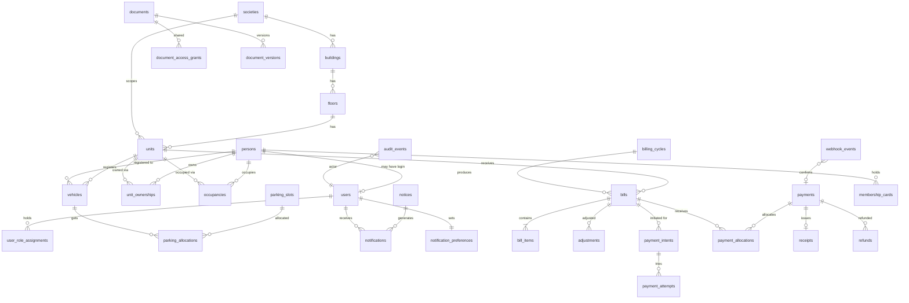

# 4. Relational Data Design (PostgreSQL)

## 4.0 Multi-society topology

- **Database per society.** This document describes the schema of **one society's database**; every society database is created from the same Flyway history.
- `society_id` columns are kept in tenant tables even though each database holds exactly one society. Reasons: portability (move a society between clusters, exports), a safety check, and keeping queries unchanged if consolidation is ever needed. The `societies` table contains a single row; tenant isolation is provided by the database boundary and distinct per-database credentials, so PostgreSQL Row-Level Security is not required in this model.
- A separate **control-plane database** holds the tenant registry, domains, database references, tenant configuration and platform admins (schemas in [doc 10, section 10.3](10-multi-tenancy.md)); it contains no resident data.
- Users, sessions, invitations and roles live in the society's database (per-society accounts).

## 4.1 Conventions

| Topic | Rule |
|---|---|
| Keys | `id UUID PRIMARY KEY` (UUIDv7, app-generated). `society_id UUID NOT NULL` on tenant-owned tables. |
| Money | `NUMERIC(14,2)` with `currency CHAR(3)`; never float. All arithmetic in `BigDecimal` with `RoundingMode.HALF_UP`, rounding at defined points (per bill item). `CHECK` constraints on signs. |
| Time | `TIMESTAMPTZ` UTC; dates for business dates (`due_date`, `start_date`). |
| Row version | `version BIGINT NOT NULL` for optimistic locking; `created_at`, `updated_at`, `created_by`. |
| History | Temporal tables use `valid_from`/`valid_to` (nullable `valid_to` = current); rows are closed, never overwritten. Exclusion constraints prevent overlaps. |
| Deletion | No hard deletes of business records. Soft state (`status`, `ended_at`, `archived_at`). Exception: privacy erasure workflow anonymises persons (4.7). Financial and audit tables are append-only (enforced by DB privileges and triggers). |
| Naming | `snake_case`, plural tables. |
| Enums | `VARCHAR` + `CHECK` (easier migrations than native enum). |

## 4.2 ER diagram

## 4.3 Table-level schema

(PK = primary key; FK = foreign key; UQ = unique; IX = index.)

### Identity and access

| Table | Key columns | Constraints / indexes |
|---|---|---|
| `societies` | `id`, `name`, `address`, `settings JSONB`, `timezone`, `currency` | PK `id` |
| `persons` | `id`, `society_id`, `full_name`, `email` (nullable), `phone` (nullable), `status`, `anonymised_at` | IX `(society_id, lower(email))`; email not unique across persons (family may share) |
| `users` | `id`, `person_id UQ FK`, `login_email CITEXT UQ`, `password_hash`, `status` (`INVITED/ACTIVE/LOCKED/DEACTIVATED`), `mfa_secret_enc`, `mfa_enabled`, `failed_attempts`, `locked_until`, `last_login_at` | UQ `login_email`; FK `person` |
| `user_role_assignments` | `id`, `user_id FK`, `role` (`ADMIN/TREASURER`), `valid_from`, `valid_to`, `granted_by FK users` | UQ partial `(user_id, role) WHERE valid_to IS NULL`; owner/tenant roles are derived, not stored |
| `invitations` | `id`, `society_id`, `person_id FK`, `token_hash UQ`, `purpose`, `expires_at`, `used_at`, `created_by` | Token stored as SHA-256 hash only |
| `password_reset_tokens` | `id`, `user_id`, `token_hash UQ`, `expires_at` (≤ 30 min), `used_at` | |
| `user_sessions` | `id` (opaque, hashed), `user_id`, `created_at`, `last_seen`, `expires_at`, `revoked_at`, `ip_hash`, `user_agent` | IX `user_id`; swept by job |
| `mfa_recovery_codes` | `id`, `user_id`, `code_hash`, `used_at` | |

### Property

| Table | Key columns | Constraints / indexes |
|---|---|---|
| `buildings` | `id`, `society_id FK`, `name`, `code` | UQ `(society_id, code)` |
| `floors` | `id`, `building_id FK`, `level_no`, `label` | UQ `(building_id, level_no)` |
| `units` | `id`, `society_id FK`, `floor_id FK`, `unit_no`, `area_sqft NUMERIC(10,2)`, `unit_type`, `status` | UQ `(society_id, floor_id, unit_no)`; IX `floor_id` |
| `unit_ownerships` | `id`, `unit_id FK`, `person_id FK`, `share_percent NUMERIC(5,2)`, `is_primary_contact`, `valid_from`, `valid_to`, `acquisition_ref` | Exclusion/trigger: active shares for a unit sum to 100; at most one primary contact active per unit; IX `(unit_id) WHERE valid_to IS NULL`; IX `(person_id) WHERE valid_to IS NULL` |
| `occupancies` | `id`, `unit_id FK`, `person_id FK`, `type`, `start_date`, `end_date`, `agreement_doc_id FK documents` | `CHECK end_date >= start_date`; IX `(unit_id) WHERE end_date IS NULL` |

Joint ownership = several active `unit_ownerships` rows per unit. Multi-unit owners = several rows per person. Ownership transfer closes rows (`valid_to`) and opens new rows in one transaction; historic bills remain tied to `unit_id` plus a snapshot `billed_to_person_id`.

### Vehicles

| Table | Key columns | Constraints / indexes |
|---|---|---|
| `vehicles` | `id`, `society_id`, `unit_id FK`, `person_id FK`, `reg_number_norm`, `reg_number_display`, `type` (`TWO_WHEELER/CAR/OTHER`), `make`, `model`, `status`, `deregistered_at` | UQ partial `(society_id, reg_number_norm) WHERE status = 'ACTIVE'`; norm = uppercase, strip spaces/hyphens |
| `parking_slots` | `id`, `society_id`, `code`, `location`, `kind` | UQ `(society_id, code)` |
| `parking_allocations` | `id`, `slot_id FK`, `unit_id FK`, `vehicle_id FK NULL`, `valid_from`, `valid_to` | Exclusion constraint: no overlapping allocation |

Duplicate check: normalisation + partial unique index; a conflict returns 409 and tells the user to contact admin (does not disclose which unit owns it to non-admins).

### Documents

| Table | Key columns | Constraints / indexes |
|---|---|---|
| `documents` | `id`, `society_id`, `category`, `title`, `visibility` (`SOCIETY/UNIT/PRIVATE/ADMIN_ONLY`), `unit_id NULL`, `owner_person_id NULL`, `current_version_id`, `status` (`PENDING_SCAN/AVAILABLE/QUARANTINED/ARCHIVED`), `retain_until`, `uploaded_by` | `CHECK` visibility/unit consistency; IX `(society_id, category, status)`; IX `unit_id` |
| `document_versions` | `id`, `document_id FK`, `storage_key UQ`, `original_filename`, `content_type_detected`, `size_bytes`, `sha256`, `scan_result`, `scanned_at` | storage key is random, never derived from filename |
| `document_access_grants` | `id`, `document_id`, `grantee_user_id` or `role` or `unit_id`, `permission`, `expires_at` | |

### Notices and notifications

| Table | Key columns | Constraints / indexes |
|---|---|---|
| `notices` | `id`, `society_id`, `title`, `body`, `status`, `publish_at`, `created_by` | IX `(society_id, status, publish_at DESC)` |
| `notifications` | `id`, `user_id FK`, `notice_id NULL`, `type`, `title`, `body`, `created_at`, `read_at` | IX `(user_id, read_at, created_at DESC)` |
| `notification_preferences` | `user_id PK`, `email_enabled`, `categories JSONB` | |
| `email_outbox` | `id`, `notification_id`, `to_address`, `status`, `attempts`, `next_attempt_at`, `last_error` | IX `(status, next_attempt_at)`; worker uses `SKIP LOCKED` |

### Billing and payments

| Table | Key columns | Constraints / indexes |
|---|---|---|
| `charge_components` | `id`, `society_id`, `code`, `name`, `basis`, `rate NUMERIC(12,4)`, `active_from`, `active_to` | UQ `(society_id, code, active_from)` |
| `billing_policies` | `id`, `society_id`, `grace_days`, `late_fee_type`, `late_fee_value`, `late_fee_cap`, `allocation_order`, `valid_from` | Versioned; bills snapshot the policy id |
| `billing_cycles` | `id`, `society_id`, `period_start`, `period_end`, `due_date`, `status` (`DRAFT/ISSUED/CLOSED`) | UQ `(society_id, period_start, period_end)` |
| `bills` | `id`, `society_id`, `cycle_id FK`, `unit_id FK`, `billed_to_person_id`, `bill_no UQ`, `issue_date`, `due_date`, `total_amount`, `status`, `version` | UQ `(cycle_id, unit_id)` prevents double billing; cached projection (see 4.5) |
| `bill_items` | `id`, `bill_id FK`, `component_id FK NULL`, `description`, `amount`, `kind` (`CHARGE/LATE_FEE/ARREARS`) | IX `bill_id`; amount > 0 |
| `adjustments` | `id`, `bill_id FK`, `amount` (signed), `reason`, `status` (`REQUESTED/APPROVED/REJECTED`), `requested_by`, `approved_by` | `CHECK` approved_by; append-only |
| `payment_intents` | `id`, `society_id`, `bill_id FK NULL` (`unit_id` for advance), `amount`, `currency`, `status` (`CREATED/REDIRECTED/CANCELLED`), `idempotency_key`, `gateway_order_id UQ`, `created_by` | UQ `(created_by, idempotency_key)`; **initiation only, never proof of payment** |
| `payment_attempts` | `id`, `intent_id`, `gateway_payment_id UQ NULL`, `status`, `failure_code`, `created_at` | Tracks retries |
| `webhook_events` | `id`, `provider`, `provider_event_id`, `signature_valid`, `payload JSONB` (PII-minimised), `received_at`, `processed_at`, `status` | UQ `(provider, provider_event_id)` gives inbox idempotency |
| `payments` | `id`, `society_id`, `unit_id`, `payer_person_id`, `amount`, `currency`, `mode` (`BANK_TRANSFER/...`), `status` (`VERIFIED/REFUNDED/CANCELLED`), `external_ref`, `verified_by`, `verified_at` | UQ `(gateway_payment_id)`; for offline: UQ `(society_id, mode, external_ref)` where ref present; verified by gateway (online) or treasurer (offline); append-only |
| `payment_allocations` | `id`, `payment_id FK`, `bill_id FK NULL`, `item_id NULL`, `amount`, `kind` (`ADVANCE/...`) | `CHECK amount > 0`; deferred trigger: `SUM(allocations) <= payment.amount` |
|`refunds`| id,payment_id FK,amount , reason , status (`REQUESTED/APPROVED/SUBMITTED/COMPLETED/FAILED`), gateway_refund_id UQ, requested_by, approved_by | `CHECK approved_by <> requested by`; sum of refunds <= payment amount (trigger) |
| `receipts` | `id`, `payment_id UQ FK`, `receipt_no UQ per society via sequence table`, `issued_at`, `pdf_storage_key`, `voided_at` | New PDF of same record; void requires reason |
|`ledger_entries`| id,society_id , unit_id , entry_date , type (`BILL/PAYMENT/ADJUSTMENT/REFUND/LATE_FEE`), ref_id , debit,credit | Append-only ; the balance source of truth |  

### Membership cards, map, audit

| Table | Key columns | Constraints / indexes |
|---|---|---|
| `membership_cards` | `id`, `society_id`, `person_id FK`, `unit_id`, `card_no UQ`, `issued_on`, `expires_on NULL`, `status` (`ACTIVE/REVOKED/EXPIRED`), `qr_token_hash UQ`, `revoked_reason` | Partial UQ one active card per `(person, unit)` |
| `map_assets` | `id`, `society_id`, `building_id NULL`, `kind` (`SVG/IMAGE/PDF`), `storage_key`, `alt_text`, `restricted` | |
| `map_unit_hotspots` | `id`, `asset_id`, `unit_id/facility_label`, `svg_element_id` | |
| `audit_events` | `id` (bigserial), `occurred_at`, `society_id`, `actor_user_id`, `actor_role`, `action`, `entity_type`, `entity_id`, `before JSONB NULL`, `after JSONB NULL`, `ip_hash`, `trace_id` | Append-only: app DB role has INSERT/SELECT only; UPDATE/DELETE blocked by trigger; IX `(entity_type, entity_id)`, IX `(actor_user_id, occurred_at)` |
| `jobs` / `shedlock` | scheduled job locks | |

## 4.4 Indexing summary

- FK columns indexed (except where redundant).
- Search: `pg_trgm` GIN on person name, unit_no, vehicle reg; `CITEXT` for email.
- Hot queries: bills by `(unit_id, status, due_date)`; notifications by `(user_id, read_at)`; documents by `(society_id, category, status)`.
- Verify with `EXPLAIN` against synthetic data sized 10x expected.

## 4.5 Preventing duplicate payments and inconsistent balances

| Risk | Control |
|---|---|
| Double-click / client retry on "Pay" | `Idempotency-Key` + UQ `(created_by, idempotency_key)` returns the same intent |
| Duplicate webhook | UQ `(provider, provider_event_id)` on `webhook_events`; processing is idempotent; second delivery is acknowledged with 200 |
| Same gateway payment through two event types | UQ on `payment.gateway_payment_id` |
| Out-of-order webhooks (e.g., refund before captured) | Apply by **state machine** with monotonic ranking; unknown-predecessor events are stored and re-evaluated by a reconciliation job; never downgrade a terminal state |
| Signature forgery | HMAC signature + timestamp tolerance, and then **confirm by fetching payment from the gateway API** before marking verified |
| Amount tampering | Server computes amount; webhook amount/currency must equal intent amount, else flagged `MISMATCH` for manual review |
| Concurrent allocation to the same bill | Lock bill row (or optimistic version) inside the same transaction |
| Overpayment | Excess becomes advance allocation (policy) or refund; never negative bill balance |
| Balance drift | Balance = `SUM(ledger_entries)` per unit; `bills.status` / `paid_amount` are derived in the same transaction as the ledger entry; nightly job recomputes and alerts on difference; DB constraints (`CHECK paid ≤ total + adjustments`) |
| Tampering | Payments, allocations, ledger, receipts, and audit tables append-only (no UPDATE/DELETE privilege); corrections = reversing entries |

### Bill status derivation

| Status | Rule |
|---|---|
| UNPAID | `paid = 0` and today ≤ `due_date` |
| PARTIALLY_PAID | `0 < paid < payable` |
| PAID | `paid ≥ payable` |
| OVERDUE | unpaid or partial and today > `due_date` (+ grace) |
| ADJUSTED | has an approved adjustment (flag in addition to payment status) |

### 4.6 Default policy placeholders (pending Q5)

| Policy | Default |
|---|---|
| Late fee | Optional; flat or % per month; capped; computed by a daily job that appends a `LATE_FEE` bill item once per period |
| Partial payment | Allocated oldest bill first, late fees → arrears → current charges (configurable) |
| Advance payment | Held as unit credit, auto-applied when next bill issues |
| Waivers | Via adjustment with approval; never by editing a bill |
| Rounding | Per item, half-up, 2 decimals |

## 4.7 Retention, deletion and privacy mapping

| Data | Rule |
|---|---|
| Financial records (bills, payments, receipts, ledger) | Retain per statutory period (jurisdiction, Q1/Q9); not deletable by users |
| Former residents' personal data | After the retention period, **anonymise** `persons` (name → "Former resident", contact nulled) while keeping financial rows intact |
| Audit events | Retain ≥ 1 year (configurable); contain IDs not raw PII |
| Documents | `retain_until` per category; scheduled purge job removes object + marks version `PURGED` with audit event |
| Sessions, tokens | Short TTL; purged daily |

## 4.8 Database access roles

| DB role | Rights |
|---|---|
| `app_runtime` | DML on business tables; INSERT/SELECT only on append-only tables; no DDL |
| `app_migrator` | DDL; used only by Flyway during release |
| `report_ro` | SELECT on reporting views (optional) |
| `backup` | Replication/dump only |
