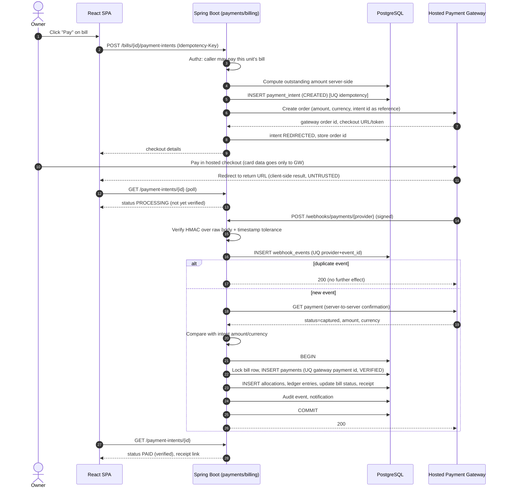
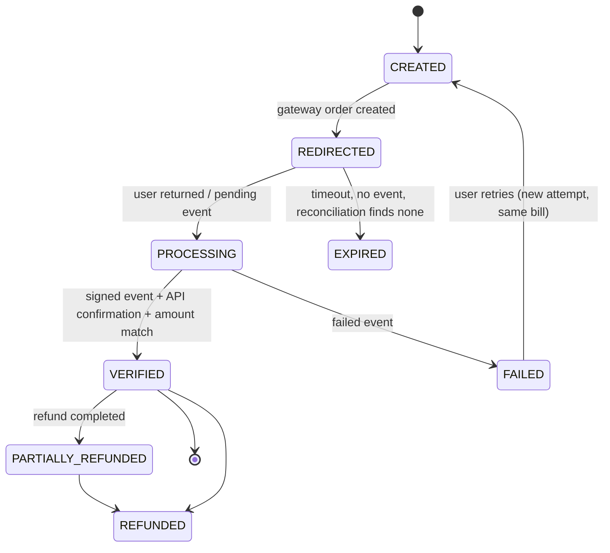

# 6. Sequence Diagrams

## 6.1 Document upload and secure download

```mermaid
sequenceDiagram
    autonumber
    actor U as User
    participant FE as React SPA
    participant API as Spring Boot (documents)
    participant DB as PostgreSQL
    participant ST as Private storage
    participant AV as ClamAV

    U->>FE: Select file, category, visibility
    FE->>API: POST /documents (multipart, CSRF token)
    API->>API: Authn + authz (can user upload to this unit/category?)
    API->>API: Enforce size limit, detect type via magic bytes, allowlist
    API->>ST: Write to quarantine key (random UUID)
    API->>DB: INSERT document + version (status PENDING_SCAN, sha256)
    API-->>FE: 202 Accepted {id, status: PENDING_SCAN}
    API->>AV: Async scan (job)
    alt clean
        AV-->>API: OK
        API->>ST: Promote/mark available
        API->>DB: status AVAILABLE, audit event
        API->>DB: create notification (if shared)
    else infected or scan error
        AV-->>API: infected/error
        API->>ST: Delete or isolate object
        API->>DB: status QUARANTINED, audit event, alert admin
    end
    Note over U,API: Download
    U->>FE: Click download
    FE->>API: POST /documents/{id}/download-link
    API->>DB: Load document with caller's allowed scope
    API->>API: Re-check authorization and status = AVAILABLE
    API->>DB: Audit event (private/sensitive docs)
    API-->>FE: Short-lived (<=60 s) single-use link or streamed response
    FE->>API: GET download (attachment, nosniff, no-store)
    API->>ST: Read object
    API-->>FE: File bytes
```

## 6.2 Online maintenance payment (initiation vs verified completion)

### Payment state machine

### Edge-case handling

| Case | Behaviour |
|---|---|
| User closes browser after paying | Webhook completes it; reconciliation job polls gateway for intents in `REDIRECTED/PROCESSING` older than N minutes. |
| Redirect says success, no webhook | Show "Processing"; reconciliation resolves; never mark paid from the redirect. |
| Duplicate webhook | Ignored via unique event id and unique `gateway_payment_id`. |
| Out-of-order webhook | Stored; state advances only forward; refund-before-capture parked until capture known (retry with backoff, then flag for review). |
| Payment failed then retry | New attempt under same or new intent; earlier failed attempt retained for audit. |
| Amount mismatch / currency mismatch | Marked `MISMATCH`, no allocation, alert treasurer. |
| Payment to an already-paid bill (double payment) | Excess becomes advance credit or flagged for refund per policy. |
| Gateway down | Pay button shows error; no intent left dangling (expiry job). |
| Daily reconciliation | Compare gateway settlement report/API list with payments; discrepancies listed in treasurer report. |
| Refund | Treasurer requests, admin approves, API call with idempotency key, refund webhook finalises, reversing ledger entries, credit note. |
