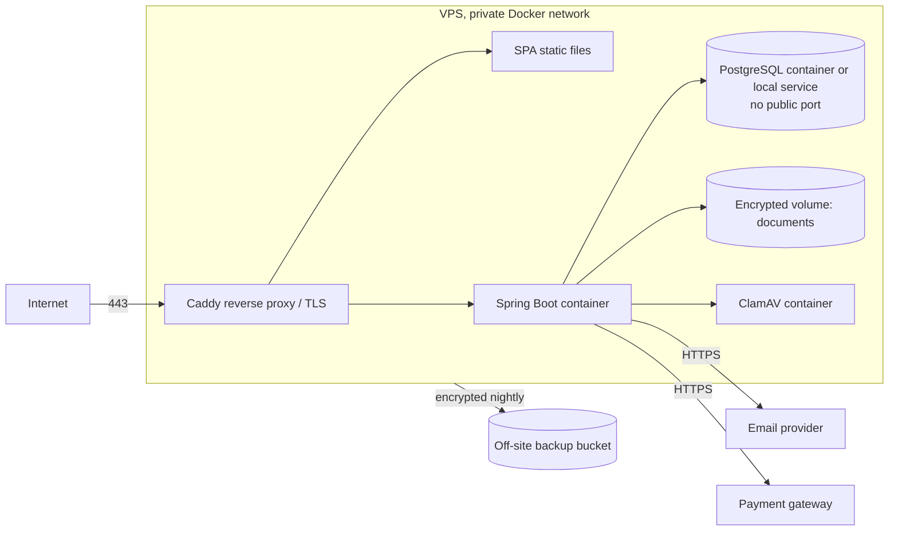

# 7. Deployment and Environment Management

## 7.1 Recommended deployment (low cost, small society)

**Option A (recommended): Single small VPS with Docker Compose** in a region that satisfies data-residency (Q11).

| Option | Pros | Cons | Cost class |
|---|---|---|---|
| **A. One VPS + Compose** | Cheapest, simple, full control | You patch OS, own backups, single point of failure | Paid (low, VPS ~ few USD/month) |
| B. PaaS app hosting + managed PostgreSQL + object storage | Managed patching, backups, PITR | Higher recurring cost, vendor specifics | Paid (moderate) |
| C. Existing cloud account (e.g., small VM + managed DB) | Scales, KMS and IAM available | Complexity, billing risk | Paid |

Free tiers are **not** assumed suitable for production: they often sleep, limit storage/bandwidth, delete idle databases, lack backups or SLAs, and may have unclear data-residency/terms. They are acceptable for demos only.

Hardening for Option A: SSH keys only, no root login, firewall allowing only 80/443 (+ restricted SSH), unattended security updates, fail2ban, DB bound to the private network, document volume and DB on encrypted disk, container images pinned and run as non-root, read-only file systems where practical, resource limits.

Document storage: MVP can use the encrypted local volume behind a `DocumentStorage` interface; migrate to S3-compatible private bucket (any provider or self-hosted MinIO) without code changes elsewhere when needed (off-site durability).

### 7.1.1 Multi-society deployment

The topology above is replicated per runtime group, as described in [doc 10](10-multi-tenancy.md):

- **Shared group (default):** one `app_instance` (or two behind the proxy for availability once justified) serving many societies; one PostgreSQL cluster holding one database per society; reverse proxy maps `host → group`, with a wildcard certificate for `*.platform-domain` (or on-demand ACME for custom domains).
- **Dedicated group (optional):** the same container image with `TENANT_GROUP=dedicated-<key>`, optionally its own DB node, for a society needing isolation, version pinning or data residency.
- **Platform app** (control plane) on a separate hostname, restricted by IP allowlist/VPN if possible, with its own database and backups.
- Onboarding, per-tenant migrations, backups, moves and offboarding are done with `societyctl` (doc 10, sections 10.4 and 10.8–10.9).

## 7.2 Free vs potentially paid

| Item | Free software | Likely paid service |
|---|---|---|
| Java, Spring Boot/Security, React, PostgreSQL, Flyway, ClamAV, Caddy/Nginx, Let's Encrypt, ZXing, OpenPDF | Yes | — |
| Hosting (VPS/PaaS), managed DB | — | Yes |
| Object storage / backup storage | MinIO self-host free | Managed buckets paid (usually small) |
| Domain name | — | Yes (yearly) |
| Email delivery | Own SMTP is unreliable (spam) | Transactional email provider (free tiers exist, limited) |
| SMS / WhatsApp | — | Per-message cost |
| Payment gateway | — | Per-transaction fees (+ possible setup/annual fees) |
| Monitoring | Prometheus/Grafana/Uptime-Kuma self-host | Hosted monitoring |
| Error tracking | Self-hosted Sentry/GlitchTip | Hosted plans |
| Code hosting + CI | Free tiers (verify limits) | Paid for private/large usage |

## 7.3 Environments

| Aspect | Local dev | Staging (optional, recommended before go-live) | Production |
|---|---|---|---|
| Purpose | Development | Release rehearsal, UAT | Live |
| Data | Synthetic seed only | Synthetic or anonymised-by-generator only | Real |
| Database | Docker PostgreSQL, own credentials | Separate instance and credentials | Separate instance, restricted network |
| Storage | Local temp dir | Separate bucket/volume | Separate, encrypted, private |
| Gateway | Sandbox/test keys + local webhook tunnel or mock | Sandbox keys | Live keys, live webhook secret |
| Email | MailHog/Mailpit (captures only) | Sandbox/allowlisted recipients | Real provider |
| Secrets | `.env.local` (git-ignored), dummy values | Staging secret store | Prod secret store, restricted access |
| Domain | localhost | Staging subdomain, basic-auth/IP limit | Public domain |
| Debug tools | OpenAPI UI, H2 console off, verbose logs | OpenAPI behind auth | Disabled |
| Spring profile | dev | staging | prod |

**Multi-society environments:** each environment has its own control-plane DB and its own tenant registry. Dev and staging seed **at least two synthetic societies with different themes, feature flags and one extension override**, so tenancy bugs show early. Real tenants are never registered in dev/staging. Gateway credentials are per society and per environment (sandbox keys outside production).

**Hard rule: no real resident data in dev/staging.** No prod dumps, no screenshots with real data in tickets. Enforcement: network separation (dev machines cannot reach prod DB), backup bucket credentials restricted to ops, documented policy, startup guard that refuses to run dev profile if the DB host matches the prod host. Bugs are reproduced with the synthetic data generator.

## 7.4 Local setup

Prerequisites: JDK (LTS), Node LTS, Docker.

1. `docker compose -f dev/compose.yml up -d` — PostgreSQL, Mailpit, ClamAV.
2. `cp dev/.env.example .env.local` — dummy secrets only.
3. `./mvnw spring-boot:run -Dspring.profiles.active=dev` — Flyway migrates + seeds.
4. `cd frontend && npm ci && npm run dev`.

Synthetic seed (Flyway repeatable migration, `dev` profile via Flyway location): 1 society, 3 buildings, ~60 units, deterministic generator (reserved IDs), one user per role with known dev-only passwords, sample bills in each state, sample vehicles, 3 dummy PDFs. Seed data is flagged `is_synthetic=true` and the prod profile fails startup if synthetic rows exist.

## 7.5 Migrations and releases

| Topic | Practice |
|---|---|
| Compatibility | **Expand + migrate + contract**: release N adds nullable/new structures; app N+1 stops using old; N+2 drops. Allows rollback of app without rolling back schema. |
| Pre-release | CI: build, unit + integration (Testcontainers PostgreSQL), migration test from empty and from previous release snapshot, security scans. |
| Schema changes | Flyway versioned SQL, forward-only, reviewed, run **per society database** by that society's `app_migrator` role via `societyctl migrate` (canary tenant first, then the rest; stop on failure). |
| Release procedure | 1) Announce maintenance window if needed. 2) Take on-demand DB backup. 3) Deploy to staging, smoke test. 4) Deploy prod (pull pinned image digest, run migrations, start new container, health check `/actuator/health/readiness`). 5) Smoke test (login, dashboard, bill view, test payment in sandbox mode on staging only). 6) Monitor 30 min. |
| Rollback | App: redeploy previous image digest (schema is backward compatible). Data: restore from backup only for destructive failure (documented RTO). |
| Versioning | Semantic version tags, changelog, images immutable. |
| Billing safety | Bill-generation and late-fee jobs are idempotent; never run during a migration; feature flag to pause. |

## 7.6 Configuration and secrets

12-factor config via environment variables; `application-{profile}.yml` holds non-secret defaults only.

Secrets inventory: DB passwords (runtime, migrator), session/CSRF keys if any, encryption key (field-level), pepper, gateway API key + webhook secret, SMTP/API key, backup encryption key, ClamAV none.

Storage: secret manager or `sops` + `age` file; access limited to 1–2 operators; rotation yearly or on staff change; rotation runbook per secret (gateway webhook secret rotation supports two active secrets during overlap). Startup validation: fail fast if a required secret is missing or equals a known dev value in prod.

## 7.7 Backup, restore, monitoring, recovery

| Topic | Plan |
|---|---|
| Targets | **RPO < 24 h** (MVP: nightly dump) improving to ≤ 15 min with WAL archiving (pgBackRest/WAL-G) when affordable; **RTO < 4 h**. |
| Database | Nightly `pg_dump` (or base backup + WAL), encrypted, copied off-site (different provider/account); retention 7 daily, 4 weekly, 6 monthly (adjust to legal retention). |
| Documents | Nightly incremental sync (`restic`/`rclone`) to off-site encrypted storage; object-storage versioning if used. |
| Config | Compose files and non-secret config in Git; secrets backup in a sealed location (two custodians). |
| Restore testing | **Quarterly** restore into an isolated scratch environment, verify row counts, ledger balance check, document hash sampling; record result and duration. A backup not restored is not a backup. |
| Monitoring | Uptime check on `/actuator/health` (public minimal) + login page; metrics via Micrometer (latency, error rate, JVM, DB pool); disk, memory, cert expiry alerts; alerts to committee admins and operator by email/push. |
| Business alerts | Webhook failures, signature failures spike, payment `MISMATCH`, reconciliation discrepancies, scan failures, job failures, ledger drift, login-failure spike. |
| Logging | Centralised on host (`journald`/Loki optional), masked, retention 30–90 days. |
| Recovery runbooks | App crash/restart, DB restore + point-in-time, lost VPS/rebuild from IaC/Compose + restore, gateway outage, suspected breach (revoke sessions, rotate secrets, preserve logs, notify), expired certificate. |
| Bus factor | Documented runbooks, a second trained operator, break-glass admin account stored offline. |
