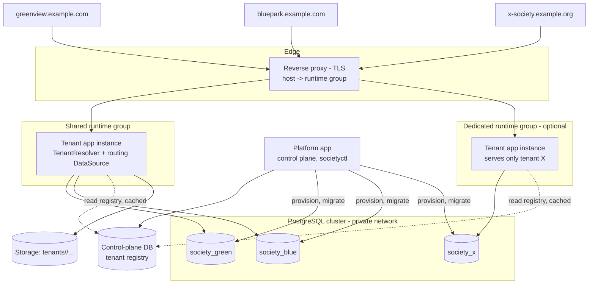
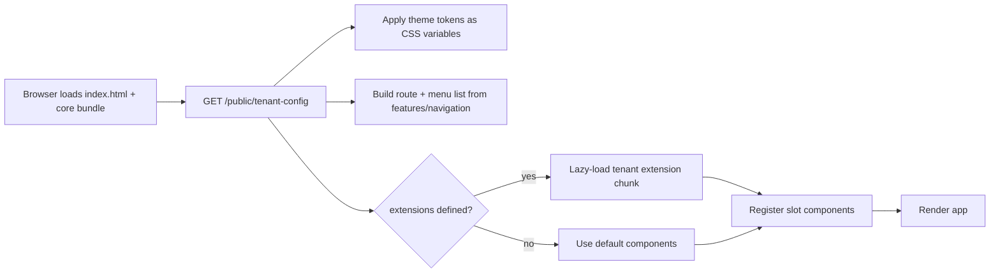

# 10. Multi-Society (Multi-Tenant) Design

This document is authoritative for tenancy. Other documents reference it. It supersedes the earlier “single society first” assumption.

## 10.1 Decisions

| # | Decision | Choice | Trade-off |
|---|---|---|---|
| T1 | Data isolation | **Database per society** (logical DB on a shared PostgreSQL cluster by default; dedicated cluster possible) | Strongest isolation, easy per-society backup/restore/delete. Costs: N migrations per release, N connection pools. Fine for < ~10–30 societies. |
| T2 | Runtime | **Hybrid:** one shared app deployment serves most societies; any society can be assigned to a dedicated instance of the same artifact | Shared = cheap and one upgrade. Dedicated = special customers/version pinning. Hybrid needs a tenant+runtime-group registry and N-1 schema compatibility. |
| T3 | Front end | **One React codebase and one build**; per-society theme + feature flags from runtime config; per-society component overrides through typed extension slots | Avoids forks. Overrides add maintenance cost, so they are governed (10.6). |
| T4 | Identity | **Per-society accounts** (users live in the society's DB). Same email in two societies = two independent accounts | Simple, no cross-tenant lookup, nothing shared to leak. No single sign-on across societies (deferred; see Q15). |
| T5 | Payments | **Each society has its own gateway account**; platform never holds funds. Credentials stored per society, encrypted | No aggregator regulation (confirm legally, Q1). |
| T6 | Onboarding | Manual via CLI (`societyctl`, < 10 societies); idempotent, resumable | Console UI deferred; CLI steps are written so a UI can call the provisioning library later. |
| T7 | Control plane | Small separate **platform** app + its own database (registry of tenants) | Platform admins are fully separated from society data. |

## 10.2 Topology



- Tenant is resolved from the **hostname** (`<key>.platform-domain` or a custom domain). Never from a header, query parameter or JWT claim that a client can set.
- The reverse proxy maps host -> runtime group. Registry data is the source (proxy config is generated from it).
- A tenant app instance only loads the tenants in its group (`TENANT_GROUP` env var); a dedicated instance cannot even open other societies' databases.

## 10.3 Control-plane schema (platform DB)

| Table | Key columns | Notes |
|---|---|---|
| `tenants` | id, tenant_key UQ (`[a-z0-9-]{3,30}`), display_name, status (`PROVISIONING/ACTIVE/SUSPENDED/OFFBOARDING/DELETED`), runtime_group, plan/flags, created_at | `tenant_key` immutable |
| `tenant_domains` | tenant_id FK, hostname UQ, is_primary, tls_status | Hostname → tenant |
| `tenant_databases` | tenant_id FK UQ, host, port, db_name, runtime_user, migrator_user, secret_ref, schema_version, last_migrated_at | Passwords never stored here; only `secret_ref` into the secret store |
| `tenant_config` | tenant_id FK, config JSONB, config_schema_version, updated_by | Theme, features, locale, limits (see 10.5) |
| `tenant_secrets_meta` | tenant_id, kind (`GATEWAY`, `EMAIL`, `DATA_KEY`), secret_ref, rotated_at | Envelope encryption (10.7) |
| `runtime_groups` | name PK, kind (`SHARED/DEDICATED`), app_version, min/max_supported_schema | Used by deploy tooling |
| `provisioning_runs` | id, tenant_id, step, status, error, started/finished | Resumable onboarding state machine |
| `platform_admins` | id, email, password_hash, mfa (mandatory) | Separate login from any society |
| `platform_audit_events` | append-only | Every provisioning/config/secret/migration action |

The control plane contains **no resident personal data**; only society metadata and operator accounts.

## 10.4 Backend design

### New modules

| Module | Responsibility |
|---|---|
| `tenancy` | `TenantResolver` (host → tenant, cached < 60 s), `TenantContext`, routing `DataSource`, per-tenant Flyway runner, tenant-aware cache/storage helpers |
| `tenant-config` | Loads/validates/serves per-tenant config; public subset to the SPA |
| `provisioning` (library) | Idempotent provisioning steps shared by CLI and future console |
| `platform-app` (separate Spring Boot app) | Control-plane API/CLI, fleet status, migrations orchestration |

Repo layout (Maven multi-module): `libs/tenancy`, `libs/provisioning`, `apps/society-app`, `apps/platform-app`, `frontend/`, `tools/societyctl`.

### Tenant resolution and routing

1. `TenantFilter` first in chain, before Spring Security: host → tenant. Unknown or `SUSPENDED` host = 404/503 page with no detail. Set `TenantContext` request-scoped.
2. `RoutingDataSource` picks the pool by `TenantContext`. **Fail closed:** there is no default DataSource; no context = exception.
3. **Pools:** one small HikariCP pool per tenant (default max 5, min idle 0, idle eviction), created lazily, bounded count. Connection budget: Σ(pool max) + admin ≤ 70% of `max_connections`. Pool metrics tagged by tenant key.
4. **Async work** (jobs, webhooks, email outbox, scan results, scheduled tasks) never rely on thread-locals implicitly: every job record stores `tenant_key`; the job runner iterates tenants and explicitly binds the context (`try/finally` clear). Virtual threads/executors use a context-propagating decorator; a unit test asserts that an un-bound thread cannot get a connection.
5. **Caches** (Caffeine) use composite keys with tenant key or one cache instance per tenant; no static mutable per-tenant state.
6. **Storage port** takes tenant from context: key prefix `tenants/{tenant_key}/...`; for object storage, separate credentials/bucket per tenant where practical.
7. **Sessions** live in the tenant's DB and the cookie is host-only (`__Host-` prefix). A session cookie from tenant A is useless on tenant B (different host and different DB).
8. **Per-tenant behaviour** is expressed as configuration or strategy beans selected by config (e.g., `LateFeePolicy`, `ReceiptTemplate`, `PaymentGateway` adapter). **Rule: no `if (tenant == "x")` in code**; enforced by an ArchUnit/grep CI check. Variations that cannot be configured become a named strategy implementation in the same repo.
9. **Tenant database schema:** identical for all tenants (single Flyway history). Tenant tables keep a `society_id` column (the singleton society row's id) for portability (moving a tenant between clusters, exports, future consolidation) and as a safety check; the DB is the real isolation boundary, so Row-Level Security is not required in the shared-cluster-per-database model.

### Schema migrations across the fleet

- `societyctl migrate [--tenant key | --all] [--canary key]`: run Flyway per tenant using that tenant's migrator account; record `schema_version` in registry.
- Release order: migrate a canary tenant → verify → remaining tenants sequentially → roll out app. **Expand/contract is mandatory** (app version N must run on schema N and N-1) because tenants migrate at different moments and dedicated groups may lag.
- A tenant migration runs at first use per tenant; if outside the group's supported range that tenant alone shows a maintenance page; others are unaffected.
- A failed tenant migration stops the rollout for remaining tenants (default) and raises an alert; each Flyway run is transactional where DDL allows.

## 10.5 Tenant configuration

Single validated JSON document per tenant (JSON Schema, versioned, migrated forward by `societyctl config upgrade`).

```json
{
  "schemaVersion": 3,
  "branding": { "name": "Greenview CHS", "logoAsset": "logo.svg", "faviconAsset": "fav.png",
    "tokens": { "colorPrimary": "#1b6b3a", "colorOnPrimary": "#ffffff", "radius": "6px", "fontStack": "system" } },
  "locale": { "default": "en-IN", "timezone": "Asia/Kolkata", "currency": "INR", "dateFormat": "dd/MM/yyyy" },
  "features": { "vehicles": true, "membershipCards": true, "buildingMap": true, "onlinePayments": true,
    "tenantsCanPay": false, "emailNotifications": true },
  "navigation": { "order": ["dashboard", "notices", "billing", "documents", "vehicles", "map"] },
  "extensions": { "dashboard": "greenview", "card": "greenview" },
  "payments": { "provider": "razorpay", "secretRef": "tenants/green/gateway" },
  "limits": { "maxUploadMb": 10, "storageQuotaMb": 2048 }
}
```

- **Public subset** (branding, locale, features, navigation, extensions keys; never secrets) served by `GET /api/v1/public/tenant-config`, cached with short TTL.
- Admin-editable subset (e.g., colours, notices or contact info) is edited in the society's own admin UI with audit; structural keys (features, payments, extensions, limits) editable only via platform tooling.
- Validation at load and on save; invalid config rejects the change and keeps the last good version.

## 10.6 Front end: one build, themed, overridable



**Layers (use the lowest layer that works):**

| Layer | Purpose | Implementation |
|---|---|---|
| 1. Theme tokens | Colours, radius, font, logo, text strings (i18n override file per tenant) | Config only |
| 2. Feature flags / navigation | Which modules, menu order, labels | Config only |
| 3. “slot overrides” | Replace specific screens/widgets with tenant components | Code in `extensions/<tenant>/`, subject to rules below |
| 4. Separate front-end repo/fork | Not supported | n/a |

**Extension mechanism**

```
frontend/src/
  core/             routing, auth, api client, tenant-config provider, slot registry
  features/         default screens (billing, vehicles, ...) built from headless hooks + presentational parts
  design-system/    tokens + primitives, themeable via CSS variables only
  extensions/
    greenview/      index.ts (registers slots), DashboardHome.tsx, MembershipCard.tsx
    bluepark/       ...
```

- Slots are a **typed, versioned contract**: e.g., `slot("dashboard.home", props: DashboardHomeProps)`, `slot("card.render", CardRenderProps)`, `slot("receipt.header", ...)`. Props are view models; extensions get data through the same feature hooks (`useBills()`, etc.), never raw `fetch`.
- Each extension is a **separate lazy chunk**, loaded only for its tenant (no extra weight for others). Build stays one artifact; the loader maps `extensions[slot]` → chunk by key.
- Rules (CI-enforced): extensions may import only `core/public` and `design-system`; no cross-extension imports; no direct API calls; every slot has a default implementation; slot contract changes follow semver with a deprecation window (one release) and a contract test per extension (render with fixture props, axe check, snapshot).
- Extensions must meet the same accessibility and performance budgets (chunk ≤ 50 KB gz).
- Authorization is never in the front end: overrides cannot reveal data the API doesn't return.
- Theming of PDFs/emails: server-side templates parameterised by tenant branding, same token set.

## 10.7 Secrets and payments per society

**Envelope encryption:** a master key (outside the DB: KMS or `age`-protected key file) encrypts a per-tenant data key; the data key encrypts that tenant's gateway credentials and TOTP secrets. Offboarding destroys the tenant data key (crypto-shredding, in addition to deleting data).

Secrets are referenced via `secret_ref`; DB passwords for each tenant are distinct (runtime and migrator roles per database); the runtime role of tenant A cannot connect to tenant B's database.

**Webhook routing:** `https://<tenant-host>/api/v1/webhooks/payments/{provider}`. The host identifies the tenant; the signature is verified using **that tenant's** webhook secret; the confirmation call uses **that tenant's** API key. A webhook delivered to the wrong host fails verification.

Each society uses its own gateway account through the `PaymentGateway` port (adapter chosen by `payments.provider`); the platform never settles funds. Gateway fees and merchant onboarding are the society's responsibility. Email uses a shared sender with per-tenant display name and reply-to by default; custom sender domain per society is optional (SPF/DKIM).

## 10.8 Onboarding a society (`societyctl onboard`)

```bash
societyctl onboard --key greenview --name "Greenview CHS" \
  --host greenview.example.com --admin-email chair@example.org \
  [--group shared|dedicated-greenview] [--template default]
```

| Step | Action | Idempotency / check |
|---|---|---|
| 1. Validate | Key format/unique, hostname free, group exists, secret store reachable | Fail fast |
| 2. Reserve | Insert `tenants` (`PROVISIONING`), `tenant_domains` | Upsert by key |
| 3. Database | Create database, runtime + migrator roles, grants (no cross-DB connect), store passwords in secret store, record in registry | Skip if exists |
| 4. Schema | Flyway baseline to current version | Flyway no-op if current |
| 5. Seed | Seed society profile, roles, default charge templates/categories/notification templates | Upsert by natural key |
| 6. Config | Create tenant config from template + overrides; validate schema | Replace |
| 7. Storage | Create `tenants/<key>/` prefix; create tenant data key (envelope) | Skip if present |
| 8. Domain/TLS | Update proxy mapping (generated from registry); certificate (wildcard cert for platform subdomains, or on-demand ACME for custom domains) | Check status |
| 9. Runtime | If dedicated group: deploy instance with `TENANT_GROUP`; else reload shared group registry | Health check |
| 10. First admin | Create person + user in INVITED state; send invite (MFA enrolment enforced at first login) | By email |
| 11. Smoke test | Resolve tenant by host, health endpoint with DB ping, login page loads config, test email in sandbox | Report |
| 12. Activate | Status = `ACTIVE`, platform audit event | |

Each step is recorded in `provisioning_runs`; a failed run can be resumed (`societyctl onboard --resume <run>`) or rolled back (`societyctl offboard --key x --abort-provisioning`). Gateway credentials are added afterward by the society (or operator) with `societyctl secret set-gateway` or the society admin screen, and live pay is disabled until test payment succeeds in sandbox.

**Other commands:** `societyctl list|status`, `suspend|resume`, `config validate|upgrade`, `migrate`, `backup|restore --tenant`, `move --tenant key --to-group g` (shared → dedicated: dump/restore + registry switch in a maintenance window), `export --tenant`, `offboard`.

**Offboarding:** `SUSPENDED` (login blocked) → data export delivered → retention period (contractual/legal, Q1/Q5) → delete database, storage prefix, data key; registry row kept as `DELETED` with timestamps for audit.

## 10.9 Operations in a multi-tenant fleet

| Concern | Approach |
|---|---|
| Backups | Per-database `pg_dump` nightly (restorable individually) plus cluster-level WAL for PITR. Restore drill rotates through tenants (each tenant restored at least once a year, a different one each quarter). |
| Monitoring | Logs and metrics carry `tenant` label (key only, no PII). Fleet dashboard: per-tenant latency, errors, pool saturation, migration version, webhook failures. Alert per tenant to that society's technical contact and to you. |
| Noisy neighbour | Per-tenant pool caps, per-tenant rate limits (key = tenant + IP/user), per-tenant job concurrency and storage quotas. |
| Version management | `runtime_groups` track app version and supported schema range; deploy tooling refuses to start a group if any of its tenants is outside range. |
| Incident response | Suspend one tenant without affecting the rest; rotate that tenant's secrets only; restore single tenant. |
| Capacity (assumption) | < 10 societies × < 500 units on one 4 vCPU / 8 GB app node and one PostgreSQL node; pools 5 each. Revisit at 20+ societies or when any society exceeds 1,000 units. |
| Cost | Shared cluster and shared app keep marginal cost per society close to storage + email + monitoring; dedicated instances roughly add a small VPS per society. |

## 10.10 Maintainability rules (summary)

1. One repository, one build artifact, one schema.
2. No tenant names in business code; CI check.
3. Tenant context is explicit, fail closed, and propagated through jobs.
4. Expand/contract migrations always; N-1 compatibility.
5. Societies differ by **config, then strategy, then slot override** only.
6. Feature-flag keys, tenant-config schema updates, default slot implementation and cross-tenant tests are versioned with tests; override budget reviewed each release (candidates promoted to config or core).
7. Platform and tenant app share libraries, not tables.

## 10.11 New open questions

| # | Question | Default / answer |
|---|---|---|
| Q1 | Who handles gateway merchant onboarding (KYC) for each society, and which providers must be supported? | Society does; adapter for selected provider. |
| Q2 | Custom domain for email or shared platform sender? | Shared sender, per-society display name. |
| Q3 | Do several societies need one login? | No; per-society accounts. |
| Q4 | Custom domains or subdomains only? | Subdomains first; custom domains via on-demand TLS later. |
| Q5 | Contract/SLA/support hours with each society (you act as a processor)? | To be defined before the second society. |
| Q6 | When are dedicated instances needed, and what is the data-residency requirement per society? | All shared by default; documented exception criteria. |
| Q7 | What if you are unavailable (bus factor)? | Document runbooks; second operator. |
